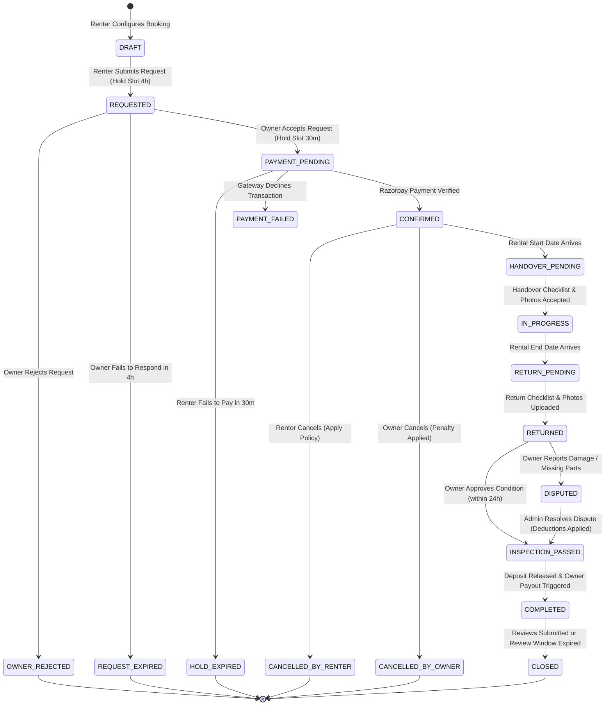

# Rental Lifecycle State-Transition Specification
## Commercial Equipment Rental Marketplace (Phase 0)

---

## 1. Booking State Machine Overview

The rental lifecycle below is a target workflow, not a guarantee that every transition is implemented. Live payment collection, deposit handling, refunds and settlements must be blocked until the payment provider and qualified legal/accounting advisers approve the exact flow in writing. A fail-closed feature gate is implemented: financial operations default to disabled, and production requires explicit enablement, production approval, and disabling sandbox-only mode. Keep the gate closed until approvals are recorded. Razorpay Route and escrow/nodal custody are not assumed to be available.



---

## 2. Comprehensive State-Transition Matrix

| From State | Event / Trigger | Initiator | Preconditions | Postconditions & Actions | To State |
|---|---|---|---|---|---|
| *None* | `CREATE_DRAFT` | Renter | Equipment `ACTIVE`; dates available | Price quote generated; slot temporarily locked for 15 mins. | `DRAFT` |
| `DRAFT` | `SUBMIT_REQUEST` | Renter | Valid delivery address & contact details | 4-hour owner review timer started; notification sent to Owner. | `REQUESTED` |
| `REQUESTED` | `OWNER_ACCEPT` | Owner | Owner is authenticated owner; request window not expired | Slot locked for 30 minutes; Razorpay payment order generated; Renter notified. | `PAYMENT_PENDING` |
| `REQUESTED` | `OWNER_REJECT` | Owner | Owner is authenticated owner | Reason recorded; slot released; Renter notified. | `OWNER_REJECTED` |
| `REQUESTED` | `TIMEOUT_EXPIRED` | System Cron | Current time > `requested_at + 4h` | Slot released; audit log created; both parties notified. | `REQUEST_EXPIRED` |
| `PAYMENT_PENDING` | `PAYMENT_SUCCESS` | Webhook / Approved Provider | Provider flow is approved; signature and exact amount match are verified against the persisted snapshot | Booking confirmed only after the approved provider confirms success; record provider references and notify parties. Fund routing must follow the separately approved design; no escrow capability is assumed. | `CONFIRMED` |
| `PAYMENT_PENDING` | `PAYMENT_FAILED` | Webhook / Gateway | Gateway returns payment failure | Renter given opportunity to retry until 30m hold expires. | `PAYMENT_FAILED` |
| `PAYMENT_PENDING` | `PAYMENT_TIMEOUT` | System Cron | Current time > `accepted_at + 30m` | Slot released back to public inventory; Renter notified. | `HOLD_EXPIRED` |
| `CONFIRMED` | `CANCEL_REQUEST` | Renter | Handover has not occurred | Cancellation fee calculated per policy; refund queued; slot released. | `CANCELLED_BY_RENTER` |
| `CONFIRMED` | `OWNER_CANCEL` | Owner | Handover has not occurred | 100% refund to renter; owner penalty rating applied; slot released. | `CANCELLED_BY_OWNER` |
| `CONFIRMED` | `DISPATCH_OR_ARRIVE` | System / Ops | `CURRENT_DATE >= rental_start_date` | Handover checklist unlocked for Renter and Owner in app. | `HANDOVER_PENDING` |
| `HANDOVER_PENDING` | `CONFIRM_HANDOVER` | Owner & Renter | Min 4 timestamped condition photos; hour meter reading; mutual OTP verified | Custody transferred to Renter; rental period officially begins. | `IN_PROGRESS` |
| `IN_PROGRESS` | `INITIATE_RETURN` | Renter / Ops | Rental period reaches end date | Return checklist unlocked; notification sent to Owner for return inspection. | `RETURN_PENDING` |
| `RETURN_PENDING` | `CONFIRM_RETURN` | Owner & Renter | Min 4 return condition photos; hour meter recorded; return OTP verified | Custody returned to Owner; 24-hour inspection review window begins. | `RETURNED` |
| `RETURNED` | `APPROVE_CONDITION` | Owner | No damages; within 24h of return | Queue deposit refund and owner settlement only through the approved provider flow; record each operation idempotently. | `INSPECTION_PASSED` |
| `RETURNED` | `AUTO_APPROVE` | System Cron | Current time > `return_time + 24h` without owner dispute | Queue refund and settlement only if an approved provider flow supports these operations and all required checks pass. | `INSPECTION_PASSED` |
| `RETURNED` | `RAISE_DAMAGE_CLAIM` | Owner | Within 24h of return; evidence photos + repair estimate provided | Deposit release frozen; Dispute case created; Admin & Renter notified. | `DISPUTED` |
| `DISPUTED` | `RESOLVE_DISPUTE` | Admin | Evidence reviewed; compensation amount determined; policy and provider flow approved | Execute only the authorized, auditable financial adjustment and balance refund through the approved provider flow. | `INSPECTION_PASSED` |
| `INSPECTION_PASSED` | `FINALIZE_SETTLEMENT` | Payment Service | Deposit refunded; owner payout successful | Booking marked completed; review invitations sent to both parties. | `COMPLETED` |
| `COMPLETED` | `CLOSE_BOOKING` | System Cron | Reviews submitted OR 14-day review window elapsed | Booking fully archived in permanent audit state. | `CLOSED` |

---

## 3. Invalid Transition & Concurrency Rejection Rules

1. **State Immutability:** Any API attempt to transition a booking to a state not explicitly permitted by the table above results in a `409 Conflict` (or `422 Unprocessable Entity`) with standard RFC 7807 problem details:
   ```json
   {
     "type": "https://api.marketplace.com/errors/invalid-state-transition",
     "title": "Invalid State Transition",
     "status": 409,
     "detail": "Cannot transition booking BKG-10492 from CONFIRMED to COMPLETED directly.",
     "currentStatus": "CONFIRMED",
     "attemptedTransition": "COMPLETED"
   }
   ```
2. **Actor Authorization:** An owner cannot confirm handover on behalf of the renter; a renter cannot accept an owner's damage claim on behalf of an admin.
3. **Database-Level Pessimistic Locking:** State-changing methods acquire a row lock (`SELECT ... FOR UPDATE`) on the `bookings` record to prevent race conditions (such as a cancellation executing simultaneously with a payment success webhook).
