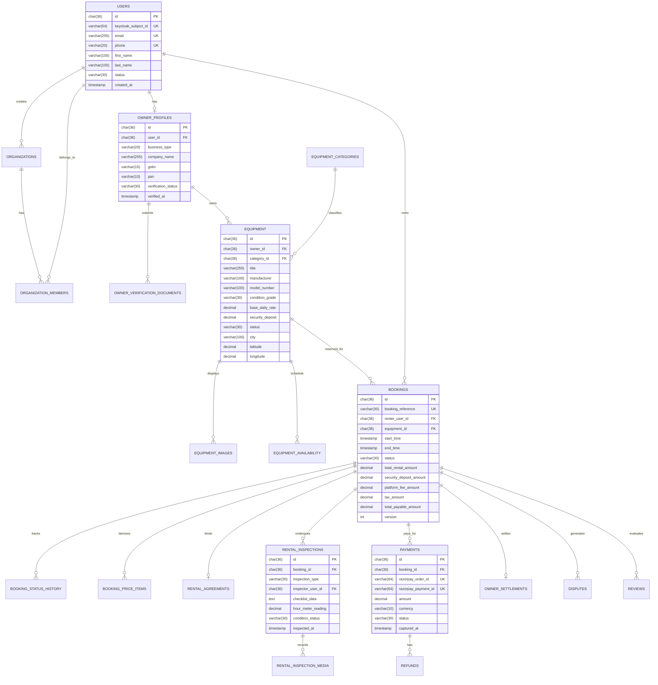

# Database Design, ERD & Flyway Schema Specification
## Commercial Equipment Rental Marketplace (Phase 0)

---

## 1. Entity-Relationship Diagram (Mermaid)



---

## 2. Core Schema DDL Specification (Flyway V1 Baseline)

### Invariants Applied:
1. `DECIMAL(12, 2)` for all monetary values (never floating-point `FLOAT` or `DOUBLE`).
2. UTC `TIMESTAMP(6)` with microsecond resolution for all timestamps.
3. Explicit foreign keys with index optimizations on join and lookup keys.
4. `INT version` column on concurrent mutable entities (e.g., `bookings`, `equipment`) for optimistic locking.
5. Soft deletion flag / status enum to guarantee no destructive deletion of financial or historical records.

```sql
-- V1__initial_marketplace_schema.sql
-- Baseline schema for B2B Commercial Equipment Rental Marketplace

-- ==========================================
-- 1. Identity & Profile Tables
-- ==========================================
CREATE TABLE users (
    id CHAR(36) NOT NULL PRIMARY KEY,
    keycloak_subject_id VARCHAR(64) NOT NULL,
    email VARCHAR(255) NOT NULL,
    phone VARCHAR(20) NOT NULL,
    first_name VARCHAR(100) NOT NULL,
    last_name VARCHAR(100) NOT NULL,
    status VARCHAR(30) NOT NULL DEFAULT 'ACTIVE',
    created_at TIMESTAMP(6) NOT NULL DEFAULT CURRENT_TIMESTAMP(6),
    updated_at TIMESTAMP(6) NOT NULL DEFAULT CURRENT_TIMESTAMP(6) ON UPDATE CURRENT_TIMESTAMP(6),
    CONSTRAINT uk_users_keycloak_sub UNIQUE (keycloak_subject_id),
    CONSTRAINT uk_users_email UNIQUE (email),
    CONSTRAINT uk_users_phone UNIQUE (phone)
) ENGINE=InnoDB DEFAULT CHARSET=utf8mb4 COLLATE=utf8mb4_unicode_ci;

CREATE TABLE organizations (
    id CHAR(36) NOT NULL PRIMARY KEY,
    legal_name VARCHAR(255) NOT NULL,
    trade_name VARCHAR(255),
    gstin VARCHAR(15),
    pan VARCHAR(10),
    created_by_user_id CHAR(36) NOT NULL,
    status VARCHAR(30) NOT NULL DEFAULT 'ACTIVE',
    created_at TIMESTAMP(6) NOT NULL DEFAULT CURRENT_TIMESTAMP(6),
    updated_at TIMESTAMP(6) NOT NULL DEFAULT CURRENT_TIMESTAMP(6) ON UPDATE CURRENT_TIMESTAMP(6),
    CONSTRAINT fk_org_created_by FOREIGN KEY (created_by_user_id) REFERENCES users(id),
    CONSTRAINT uk_org_gstin UNIQUE (gstin)
) ENGINE=InnoDB DEFAULT CHARSET=utf8mb4 COLLATE=utf8mb4_unicode_ci;

CREATE TABLE organization_members (
    id CHAR(36) NOT NULL PRIMARY KEY,
    organization_id CHAR(36) NOT NULL,
    user_id CHAR(36) NOT NULL,
    member_role VARCHAR(30) NOT NULL DEFAULT 'MEMBER',
    created_at TIMESTAMP(6) NOT NULL DEFAULT CURRENT_TIMESTAMP(6),
    CONSTRAINT fk_om_org FOREIGN KEY (organization_id) REFERENCES organizations(id),
    CONSTRAINT fk_om_user FOREIGN KEY (user_id) REFERENCES users(id),
    CONSTRAINT uk_org_user UNIQUE (organization_id, user_id)
) ENGINE=InnoDB DEFAULT CHARSET=utf8mb4 COLLATE=utf8mb4_unicode_ci;

CREATE TABLE owner_profiles (
    id CHAR(36) NOT NULL PRIMARY KEY,
    user_id CHAR(36) NOT NULL,
    organization_id CHAR(36),
    business_type VARCHAR(30) NOT NULL, -- INDIVIDUAL, PROPRIETORSHIP, PVT_LTD, PARTNERSHIP
    bank_account_number VARCHAR(34),
    bank_ifsc VARCHAR(11),
    bank_account_holder_name VARCHAR(255),
    razorpay_linked_account_id VARCHAR(64),
    verification_status VARCHAR(30) NOT NULL DEFAULT 'PENDING_SUBMISSION', -- PENDING_SUBMISSION, UNDER_REVIEW, VERIFIED, REJECTED, SUSPENDED
    rejection_reason TEXT,
    verified_at TIMESTAMP(6) NULL,
    verified_by_user_id CHAR(36) NULL,
    created_at TIMESTAMP(6) NOT NULL DEFAULT CURRENT_TIMESTAMP(6),
    updated_at TIMESTAMP(6) NOT NULL DEFAULT CURRENT_TIMESTAMP(6) ON UPDATE CURRENT_TIMESTAMP(6),
    CONSTRAINT fk_owner_user FOREIGN KEY (user_id) REFERENCES users(id),
    CONSTRAINT fk_owner_org FOREIGN KEY (organization_id) REFERENCES organizations(id),
    CONSTRAINT fk_owner_verifier FOREIGN KEY (verified_by_user_id) REFERENCES users(id),
    CONSTRAINT uk_owner_user UNIQUE (user_id)
) ENGINE=InnoDB DEFAULT CHARSET=utf8mb4 COLLATE=utf8mb4_unicode_ci;

CREATE TABLE owner_verification_documents (
    id CHAR(36) NOT NULL PRIMARY KEY,
    owner_profile_id CHAR(36) NOT NULL,
    document_type VARCHAR(50) NOT NULL, -- GST_CERTIFICATE, PAN_CARD, CANCELLED_CHEQUE, AADHAAR
    storage_object_key VARCHAR(512) NOT NULL,
    original_filename VARCHAR(255) NOT NULL,
    file_mime_type VARCHAR(100) NOT NULL,
    file_size_bytes BIGINT NOT NULL,
    uploaded_at TIMESTAMP(6) NOT NULL DEFAULT CURRENT_TIMESTAMP(6),
    verified_status VARCHAR(30) NOT NULL DEFAULT 'PENDING',
    CONSTRAINT fk_doc_owner FOREIGN KEY (owner_profile_id) REFERENCES owner_profiles(id)
) ENGINE=InnoDB DEFAULT CHARSET=utf8mb4 COLLATE=utf8mb4_unicode_ci;

-- ==========================================
-- 2. Equipment Catalogue & Availability
-- ==========================================
CREATE TABLE equipment_categories (
    id CHAR(36) NOT NULL PRIMARY KEY,
    parent_category_id CHAR(36) NULL,
    slug VARCHAR(100) NOT NULL,
    name VARCHAR(150) NOT NULL,
    description TEXT,
    icon_object_key VARCHAR(512),
    is_active BOOLEAN NOT NULL DEFAULT TRUE,
    created_at TIMESTAMP(6) NOT NULL DEFAULT CURRENT_TIMESTAMP(6),
    CONSTRAINT uk_category_slug UNIQUE (slug),
    CONSTRAINT fk_category_parent FOREIGN KEY (parent_category_id) REFERENCES equipment_categories(id)
) ENGINE=InnoDB DEFAULT CHARSET=utf8mb4 COLLATE=utf8mb4_unicode_ci;

CREATE TABLE equipment (
    id CHAR(36) NOT NULL PRIMARY KEY,
    owner_id CHAR(36) NOT NULL,
    category_id CHAR(36) NOT NULL,
    title VARCHAR(255) NOT NULL,
    description TEXT NOT NULL,
    manufacturer VARCHAR(100) NOT NULL,
    model_number VARCHAR(100) NOT NULL,
    serial_number VARCHAR(100),
    year_of_manufacture INT,
    condition_grade VARCHAR(30) NOT NULL DEFAULT 'GOOD', -- EXCELLENT, GOOD, FAIR
    specifications_json JSON,
    base_daily_rate DECIMAL(12, 2) NOT NULL,
    base_weekly_rate DECIMAL(12, 2) NULL,
    security_deposit DECIMAL(12, 2) NOT NULL,
    minimum_rental_days INT NOT NULL DEFAULT 1,
    delivery_supported BOOLEAN NOT NULL DEFAULT FALSE,
    pickup_supported BOOLEAN NOT NULL DEFAULT TRUE,
    delivery_charge_flat DECIMAL(12, 2) DEFAULT 0.00,
    address_line VARCHAR(255) NOT NULL,
    city VARCHAR(100) NOT NULL,
    postal_code VARCHAR(20) NOT NULL,
    latitude DECIMAL(10, 7) NOT NULL,
    longitude DECIMAL(10, 7) NOT NULL,
    status VARCHAR(30) NOT NULL DEFAULT 'DRAFT', -- DRAFT, PENDING_APPROVAL, ACTIVE, REJECTED, SUSPENDED, DECOMMISSIONED
    version INT NOT NULL DEFAULT 0,
    created_at TIMESTAMP(6) NOT NULL DEFAULT CURRENT_TIMESTAMP(6),
    updated_at TIMESTAMP(6) NOT NULL DEFAULT CURRENT_TIMESTAMP(6) ON UPDATE CURRENT_TIMESTAMP(6),
    CONSTRAINT fk_eq_owner FOREIGN KEY (owner_id) REFERENCES owner_profiles(id),
    CONSTRAINT fk_eq_category FOREIGN KEY (category_id) REFERENCES equipment_categories(id),
    INDEX idx_eq_search (status, category_id, city),
    INDEX idx_eq_geo (latitude, longitude)
) ENGINE=InnoDB DEFAULT CHARSET=utf8mb4 COLLATE=utf8mb4_unicode_ci;

CREATE TABLE equipment_images (
    id CHAR(36) NOT NULL PRIMARY KEY,
    equipment_id CHAR(36) NOT NULL,
    storage_object_key VARCHAR(512) NOT NULL,
    is_primary BOOLEAN NOT NULL DEFAULT FALSE,
    display_order INT NOT NULL DEFAULT 0,
    created_at TIMESTAMP(6) NOT NULL DEFAULT CURRENT_TIMESTAMP(6),
    CONSTRAINT fk_img_equipment FOREIGN KEY (equipment_id) REFERENCES equipment(id) ON DELETE CASCADE
) ENGINE=InnoDB DEFAULT CHARSET=utf8mb4 COLLATE=utf8mb4_unicode_ci;

-- ==========================================
-- 3. Bookings, Holds & Concurrency Protection
-- ==========================================
CREATE TABLE bookings (
    id CHAR(36) NOT NULL PRIMARY KEY,
    booking_reference VARCHAR(32) NOT NULL,
    renter_user_id CHAR(36) NOT NULL,
    equipment_id CHAR(36) NOT NULL,
    start_time TIMESTAMP(6) NOT NULL,
    end_time TIMESTAMP(6) NOT NULL,
    status VARCHAR(30) NOT NULL DEFAULT 'DRAFT',
    hold_expires_at TIMESTAMP(6) NULL,
    delivery_option VARCHAR(30) NOT NULL DEFAULT 'PICKUP', -- PICKUP, OWNER_DELIVERY
    delivery_address_json JSON,
    
    -- Monetary Snapshot (immutable once accepted/confirmed)
    currency VARCHAR(10) NOT NULL DEFAULT 'INR',
    base_rental_amount DECIMAL(12, 2) NOT NULL,
    delivery_charge DECIMAL(12, 2) NOT NULL DEFAULT 0.00,
    security_deposit_amount DECIMAL(12, 2) NOT NULL DEFAULT 0.00,
    platform_fee_amount DECIMAL(12, 2) NOT NULL DEFAULT 0.00,
    tax_amount DECIMAL(12, 2) NOT NULL DEFAULT 0.00,
    total_payable_amount DECIMAL(12, 2) NOT NULL,
    owner_earnings_estimated DECIMAL(12, 2) NOT NULL,

    version INT NOT NULL DEFAULT 0,
    created_at TIMESTAMP(6) NOT NULL DEFAULT CURRENT_TIMESTAMP(6),
    updated_at TIMESTAMP(6) NOT NULL DEFAULT CURRENT_TIMESTAMP(6) ON UPDATE CURRENT_TIMESTAMP(6),
    CONSTRAINT uk_booking_reference UNIQUE (booking_reference),
    CONSTRAINT fk_bkg_renter FOREIGN KEY (renter_user_id) REFERENCES users(id),
    CONSTRAINT fk_bkg_equipment FOREIGN KEY (equipment_id) REFERENCES equipment(id),
    INDEX idx_bkg_dates (equipment_id, start_time, end_time, status)
) ENGINE=InnoDB DEFAULT CHARSET=utf8mb4 COLLATE=utf8mb4_unicode_ci;

CREATE TABLE booking_status_history (
    id CHAR(36) NOT NULL PRIMARY KEY,
    booking_id CHAR(36) NOT NULL,
    from_status VARCHAR(30),
    to_status VARCHAR(30) NOT NULL,
    changed_by_user_id CHAR(36) NOT NULL,
    reason_or_notes TEXT,
    created_at TIMESTAMP(6) NOT NULL DEFAULT CURRENT_TIMESTAMP(6),
    CONSTRAINT fk_bsh_booking FOREIGN KEY (booking_id) REFERENCES bookings(id) ON DELETE CASCADE,
    CONSTRAINT fk_bsh_user FOREIGN KEY (changed_by_user_id) REFERENCES users(id)
) ENGINE=InnoDB DEFAULT CHARSET=utf8mb4 COLLATE=utf8mb4_unicode_ci;

CREATE TABLE booking_price_items (
    id CHAR(36) NOT NULL PRIMARY KEY,
    booking_id CHAR(36) NOT NULL,
    item_type VARCHAR(50) NOT NULL, -- BASE_RENTAL, DELIVERY, SECURITY_DEPOSIT, PLATFORM_CONVENIENCE_FEE, GST_18
    description VARCHAR(255) NOT NULL,
    amount DECIMAL(12, 2) NOT NULL,
    created_at TIMESTAMP(6) NOT NULL DEFAULT CURRENT_TIMESTAMP(6),
    CONSTRAINT fk_bpi_booking FOREIGN KEY (booking_id) REFERENCES bookings(id) ON DELETE CASCADE
) ENGINE=InnoDB DEFAULT CHARSET=utf8mb4 COLLATE=utf8mb4_unicode_ci;

-- ==========================================
-- 4. Payments, Settlements & Webhooks
-- ==========================================
CREATE TABLE payments (
    id CHAR(36) NOT NULL PRIMARY KEY,
    booking_id CHAR(36) NOT NULL,
    razorpay_order_id VARCHAR(64) NOT NULL,
    razorpay_payment_id VARCHAR(64) NULL,
    razorpay_signature VARCHAR(255) NULL,
    amount DECIMAL(12, 2) NOT NULL,
    currency VARCHAR(10) NOT NULL DEFAULT 'INR',
    status VARCHAR(30) NOT NULL DEFAULT 'CREATED', -- CREATED, AUTHORIZED, CAPTURED, FAILED, REFUNDED
    failure_reason TEXT,
    created_at TIMESTAMP(6) NOT NULL DEFAULT CURRENT_TIMESTAMP(6),
    updated_at TIMESTAMP(6) NOT NULL DEFAULT CURRENT_TIMESTAMP(6) ON UPDATE CURRENT_TIMESTAMP(6),
    CONSTRAINT fk_pay_booking FOREIGN KEY (booking_id) REFERENCES bookings(id),
    CONSTRAINT uk_pay_order UNIQUE (razorpay_order_id),
    CONSTRAINT uk_pay_payment UNIQUE (razorpay_payment_id)
) ENGINE=InnoDB DEFAULT CHARSET=utf8mb4 COLLATE=utf8mb4_unicode_ci;

CREATE TABLE payment_webhook_events (
    id CHAR(36) NOT NULL PRIMARY KEY,
    event_id VARCHAR(100) NOT NULL,
    event_type VARCHAR(100) NOT NULL,
    payload_hash VARCHAR(64) NOT NULL,
    raw_payload LONGTEXT NOT NULL,
    status VARCHAR(30) NOT NULL DEFAULT 'PENDING', -- PENDING, PROCESSED, FAILED, IGNORED
    processed_at TIMESTAMP(6) NULL,
    error_message TEXT,
    created_at TIMESTAMP(6) NOT NULL DEFAULT CURRENT_TIMESTAMP(6),
    CONSTRAINT uk_webhook_event_id UNIQUE (event_id)
) ENGINE=InnoDB DEFAULT CHARSET=utf8mb4 COLLATE=utf8mb4_unicode_ci;

CREATE TABLE refunds (
    id CHAR(36) NOT NULL PRIMARY KEY,
    booking_id CHAR(36) NOT NULL,
    payment_id CHAR(36) NOT NULL,
    razorpay_refund_id VARCHAR(64) NOT NULL,
    amount DECIMAL(12, 2) NOT NULL,
    refund_type VARCHAR(50) NOT NULL, -- DEPOSIT_RETURN, CANCELLATION_REFUND, DISPUTE_ADJUSTMENT
    status VARCHAR(30) NOT NULL DEFAULT 'PROCESSED',
    created_at TIMESTAMP(6) NOT NULL DEFAULT CURRENT_TIMESTAMP(6),
    CONSTRAINT fk_ref_booking FOREIGN KEY (booking_id) REFERENCES bookings(id),
    CONSTRAINT fk_ref_payment FOREIGN KEY (payment_id) REFERENCES payments(id),
    CONSTRAINT uk_refund_booking_type UNIQUE (booking_id, refund_type),
    CONSTRAINT uk_razorpay_refund UNIQUE (razorpay_refund_id)
) ENGINE=InnoDB DEFAULT CHARSET=utf8mb4 COLLATE=utf8mb4_unicode_ci;

CREATE TABLE owner_settlements (
    id CHAR(36) NOT NULL PRIMARY KEY,
    booking_id CHAR(36) NOT NULL,
    owner_profile_id CHAR(36) NOT NULL,
    gross_rental_amount DECIMAL(12, 2) NOT NULL,
    platform_commission_amount DECIMAL(12, 2) NOT NULL,
    net_payout_amount DECIMAL(12, 2) NOT NULL,
    owner_damage_award_amount DECIMAL(12, 2) NOT NULL DEFAULT 0.00,
    razorpay_transfer_id VARCHAR(64),
    status VARCHAR(30) NOT NULL DEFAULT 'PENDING', -- PENDING, ON_HOLD, RELEASED, FAILED
    released_at TIMESTAMP(6) NULL,
    release_after TIMESTAMP(6) NULL,
    created_at TIMESTAMP(6) NOT NULL DEFAULT CURRENT_TIMESTAMP(6),
    CONSTRAINT fk_set_booking FOREIGN KEY (booking_id) REFERENCES bookings(id),
    CONSTRAINT fk_set_owner FOREIGN KEY (owner_profile_id) REFERENCES owner_profiles(id),
    CONSTRAINT uk_set_booking UNIQUE (booking_id)
) ENGINE=InnoDB DEFAULT CHARSET=utf8mb4 COLLATE=utf8mb4_unicode_ci;

-- ==========================================
-- 5. Rental Operations, Inspections & Disputes
-- ==========================================
CREATE TABLE rental_inspections (
    id CHAR(36) NOT NULL PRIMARY KEY,
    booking_id CHAR(36) NOT NULL,
    inspection_type VARCHAR(30) NOT NULL, -- HANDOVER, RETURN
    inspector_user_id CHAR(36) NOT NULL,
    hour_meter_reading DECIMAL(10, 2) NULL,
    fuel_or_battery_level VARCHAR(50) NULL,
    checklist_json JSON NOT NULL,
    condition_summary TEXT,
    otp_verified BOOLEAN NOT NULL DEFAULT FALSE,
    inspected_at TIMESTAMP(6) NOT NULL DEFAULT CURRENT_TIMESTAMP(6),
    CONSTRAINT fk_insp_booking FOREIGN KEY (booking_id) REFERENCES bookings(id),
    CONSTRAINT fk_insp_user FOREIGN KEY (inspector_user_id) REFERENCES users(id)
) ENGINE=InnoDB DEFAULT CHARSET=utf8mb4 COLLATE=utf8mb4_unicode_ci;

CREATE TABLE rental_inspection_media (
    id CHAR(36) NOT NULL PRIMARY KEY,
    inspection_id CHAR(36) NOT NULL,
    storage_object_key VARCHAR(512) NOT NULL,
    media_tag VARCHAR(50) NOT NULL, -- FRONT, REAR, CONTROL_PANEL, HOUR_METER, DAMAGE_CLOSEUP
    geo_latitude DECIMAL(10, 7) NULL,
    geo_longitude DECIMAL(10, 7) NULL,
    captured_at TIMESTAMP(6) NOT NULL DEFAULT CURRENT_TIMESTAMP(6),
    CONSTRAINT fk_media_inspection FOREIGN KEY (inspection_id) REFERENCES rental_inspections(id) ON DELETE CASCADE
) ENGINE=InnoDB DEFAULT CHARSET=utf8mb4 COLLATE=utf8mb4_unicode_ci;

CREATE TABLE disputes (
    id CHAR(36) NOT NULL PRIMARY KEY,
    booking_id CHAR(36) NOT NULL,
    raised_by_user_id CHAR(36) NOT NULL,
    dispute_category VARCHAR(50) NOT NULL, -- EQUIPMENT_DAMAGE, MISSING_ACCESSORY, LATE_RETURN, WRONG_MACHINE
    claim_amount DECIMAL(12, 2) NOT NULL,
    approved_deduction_amount DECIMAL(12, 2) DEFAULT 0.00,
    description TEXT NOT NULL,
    status VARCHAR(30) NOT NULL DEFAULT 'OPEN', -- OPEN, UNDER_INVESTIGATION, RESOLVED, REJECTED
    resolution_notes TEXT,
    resolved_by_user_id CHAR(36) NULL,
    resolved_at TIMESTAMP(6) NULL,
    created_at TIMESTAMP(6) NOT NULL DEFAULT CURRENT_TIMESTAMP(6),
    updated_at TIMESTAMP(6) NOT NULL DEFAULT CURRENT_TIMESTAMP(6) ON UPDATE CURRENT_TIMESTAMP(6),
    CONSTRAINT fk_disp_booking FOREIGN KEY (booking_id) REFERENCES bookings(id),
    CONSTRAINT fk_disp_raiser FOREIGN KEY (raised_by_user_id) REFERENCES users(id),
    CONSTRAINT fk_disp_resolver FOREIGN KEY (resolved_by_user_id) REFERENCES users(id)
) ENGINE=InnoDB DEFAULT CHARSET=utf8mb4 COLLATE=utf8mb4_unicode_ci;

CREATE TABLE reviews (
    id CHAR(36) NOT NULL PRIMARY KEY,
    booking_id CHAR(36) NOT NULL,
    reviewer_user_id CHAR(36) NOT NULL,
    reviewee_user_id CHAR(36) NOT NULL,
    equipment_id CHAR(36) NOT NULL,
    rating INT NOT NULL CHECK (rating >= 1 AND rating <= 5),
    comments TEXT,
    is_published BOOLEAN NOT NULL DEFAULT TRUE,
    created_at TIMESTAMP(6) NOT NULL DEFAULT CURRENT_TIMESTAMP(6),
    CONSTRAINT fk_rev_booking FOREIGN KEY (booking_id) REFERENCES bookings(id),
    CONSTRAINT fk_rev_reviewer FOREIGN KEY (reviewer_user_id) REFERENCES users(id),
    CONSTRAINT fk_rev_reviewee FOREIGN KEY (reviewee_user_id) REFERENCES users(id),
    CONSTRAINT fk_rev_equipment FOREIGN KEY (equipment_id) REFERENCES equipment(id),
    CONSTRAINT uk_rev_booking_reviewer UNIQUE (booking_id, reviewer_user_id)
) ENGINE=InnoDB DEFAULT CHARSET=utf8mb4 COLLATE=utf8mb4_unicode_ci;

CREATE TABLE audit_logs (
    id CHAR(36) NOT NULL PRIMARY KEY,
    actor_user_id CHAR(36) NULL,
    action VARCHAR(100) NOT NULL,
    entity_name VARCHAR(100) NOT NULL,
    entity_id VARCHAR(64) NOT NULL,
    details_json JSON NULL,
    ip_address VARCHAR(45) NULL,
    created_at TIMESTAMP(6) NOT NULL DEFAULT CURRENT_TIMESTAMP(6),
    INDEX idx_audit_lookup (entity_name, entity_id)
) ENGINE=InnoDB DEFAULT CHARSET=utf8mb4 COLLATE=utf8mb4_unicode_ci;
```

---

## 3. Booking Concurrency & Overlap Prevention Strategy

To guarantee that two concurrent renters cannot book overlapping dates for the same physical equipment unit:

1. **Transactional Row Lock on Equipment Master:**
   When booking request creation begins, the booking service executes:
   ```sql
   SELECT id, status FROM equipment WHERE id = :equipmentId FOR UPDATE;
   ```
2. **Explicit Overlap Query within the Lock:**
   A conflicting reservation exists if any booking for `:equipmentId` satisfies:
   ```sql
   SELECT COUNT(*) FROM bookings
   WHERE equipment_id = :equipmentId
     AND status IN ('REQUESTED', 'PAYMENT_PENDING', 'CONFIRMED', 'HANDOVER_PENDING', 'IN_PROGRESS', 'RETURN_PENDING')
     AND (hold_expires_at IS NULL OR hold_expires_at > UTC_TIMESTAMP())
     AND start_time < :requestedEndTime
     AND end_time > :requestedStartTime;
   ```
3. **If Count > 0:** Abort transaction and return `409 Conflict` ("The requested equipment is no longer available for the selected dates.").
4. **If Count == 0:** Insert new `bookings` record with `status = 'REQUESTED'` and `hold_expires_at = UTC_TIMESTAMP() + INTERVAL 4 HOUR`.
